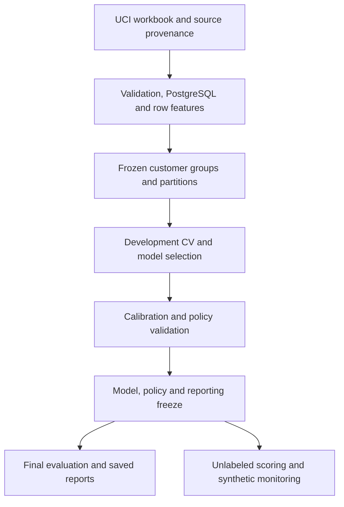
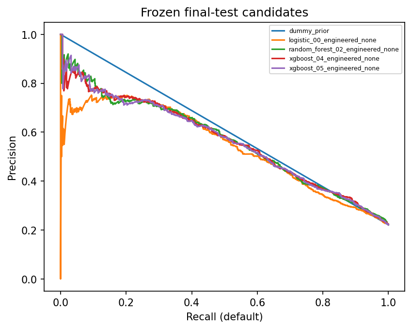
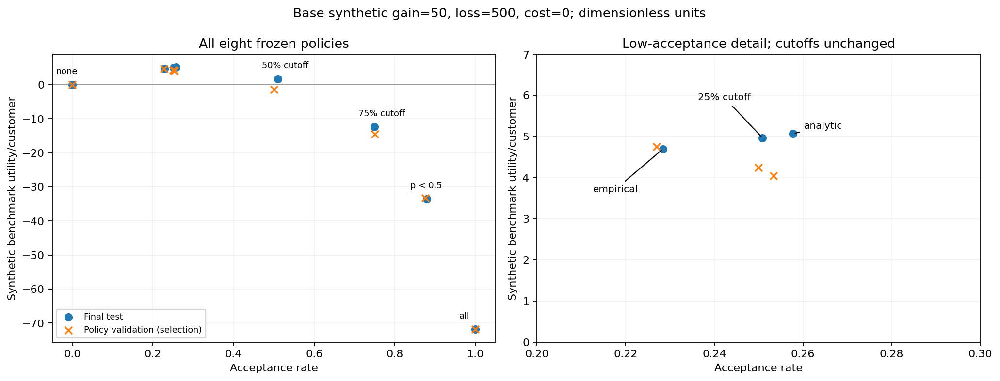
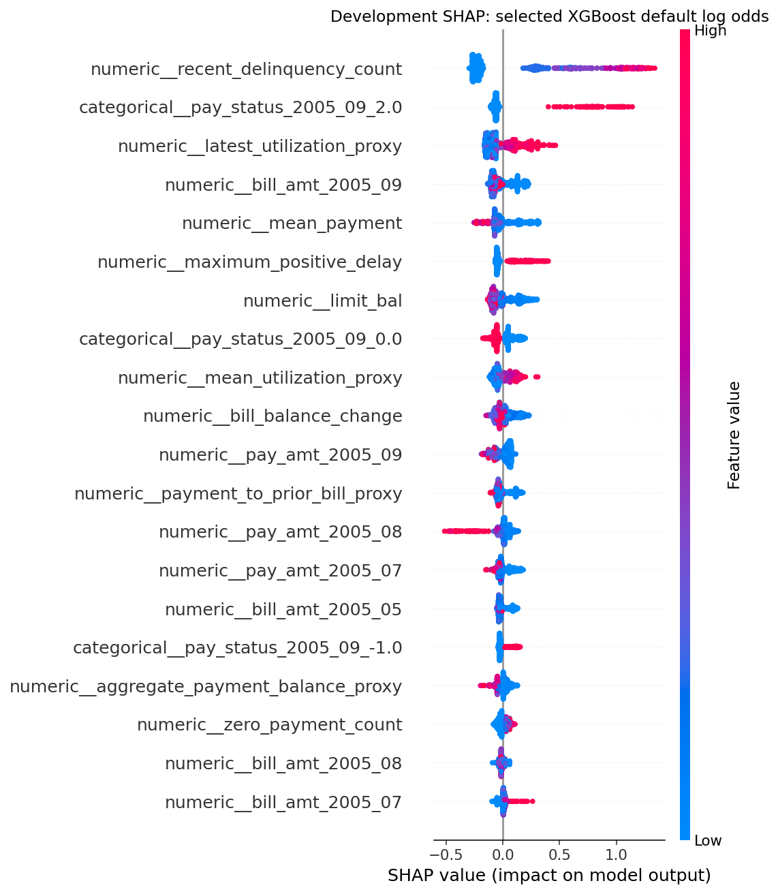

# Credit Risk & Lending Decision Science

Credit Risk is a reproducible study of next-month default for existing credit-card accounts. It validates historical UCI customer snapshots, compares classification models, assesses probability calibration, evaluates hypothetical lending policies, and scores unlabeled records with a frozen model bundle.

**Stack:** Python 3.12 · PostgreSQL · pandas · scikit-learn · XGBoost · SHAP · MLflow · Docker · GitHub Actions

## What problem does it solve?

The study asks whether financial-history models improve risk ranking and probability estimates over simple references, and how those estimates behave under explicit decision assumptions. The intended use is educational model evaluation and simulated allocation analysis. It does not establish new-applicant approval outcomes or the effect of extending or withholding credit.

The source contains 30,000 Taiwanese credit-card customer snapshots with April–September 2005 histories. Prediction assumes all included September fields are available at month end. One customer supplies one labeled snapshot; the six monthly histories are inputs, not six separately labeled observations.

## Architecture



[Architecture](docs/architecture.md) describes component responsibilities, storage and execution boundaries. Base fitting, calibration fitting, policy selection and final evaluation use separate partitions.

## What the project demonstrates

- Traceable data processing: immutable source provenance, transactional/idempotent ingestion, SQL/Python feature parity, quarantine and row reconciliation.
- Isolated model development: financial-profile grouping, frozen 60/15/10/15 partitions, five development folds and fold-fitted preprocessing.
- Measured model comparison: dummy, logistic, forest and XGBoost references; bounded AP searches; engineered-feature and weighting comparisons.
- Probability and decision assessment: separate calibration, validation-selected simulated policies, fixed payoff sensitivity and paired group-bootstrap intervals.
- Reproducible delivery: versioned model bundle, database-independent CSV/Parquet scoring, synthetic monitoring, locked dependencies and fixture CI.

## Measured evaluation results

Development cross-validation selected the unweighted 100-tree combined-feature XGBoost (`xgboost_05_engineered_none`). Policy validation retained raw probabilities. The model, probability mapping and policies were frozen before the 4,500-account final evaluation.

| Selected-model final-test metric | Estimate | 95% interval |
| --- | ---: | --- |
| Average precision (AP) | 0.5642 | [0.5338, 0.5958] |
| ROC-AUC | 0.7940 | [0.7776, 0.8096] |
| Log loss | 0.4233 | [0.4065, 0.4412] |
| Brier score | 0.1332 | [0.1266, 0.1406] |

Intervals use 1,000 seed-42 paired samples of the 4,378 final-test financial-profile groups. They describe evaluation-sample uncertainty conditional on the fitted models and frozen policies, not model-development uncertainty or temporal/external robustness.

| Frozen reference | Final-test AP | Final-test log loss |
| --- | ---: | ---: |
| Constant-prior dummy | 0.2213 | 0.5286 |
| Regularized logistic regression | 0.5415 | 0.4352 |
| Random forest | 0.5664 | 0.4230 |
| Selected XGBoost | 0.5642 | 0.4233 |

The forest has slightly higher test AP and lower log loss; the selected model did not win every final-test metric. Its paired AP difference from the forest is −0.00214 [−0.01017, 0.00655]. Test comparisons do not replace the development-selected model. [Complete evaluation and uncertainty](reports/results.md) retain all frozen candidates and paired comparisons.

Calibration log loss on policy validation was 0.4330 for raw probabilities, 0.4362 for sigmoid and 0.4560 for isotonic. Under synthetic gain 50, default loss 500 and processing cost 0, the validation-selected cutoff 0.085 accepts 1,028/4,500 test accounts (22.84%), with 55 defaults (5.35% accepted default rate). Benchmark utility is 4.70 [2.90, 6.37] dimensionless units per customer. The analytic policy yields 5.0667 units per customer; it does not become a replacement based on the test result. These are hypothetical payoffs, not profit, avoided loss or causal lending effects. [Calibration and policies](docs/calibration_policies.md) explain the assumptions and all scenarios.

## Evaluation and explanation figures

The existing figures show the frozen study. Full-resolution files and additional reliability, confusion and sensitivity plots are in [the results report](reports/results.md#figures-and-limitations).

**Risk ranking on the final test**



**Acceptance and hypothetical utility**



**Selected-model explanations**



SHAP explains raw default log odds on a fixed development sample. It is not causal evidence or an attribution of calibrated probability. [Explanations and descriptive slices](docs/explanations.md) document model identity, sampling and support limits.

## Repository structure

| Path | Contents |
| --- | --- |
| `src/credit_risk/`, `scripts/` | Validation, feature/split logic, modeling, decisioning, inference and execution CLIs |
| `sql/`, `configs/` | Isolated PostgreSQL definitions and recorded experiment configuration |
| `artifacts/` tracked files | Source/feature contracts, frozen split assignments and compact provenance |
| `bundles/` | Minimal scoring archive, checksum, delivery manifest and notices |
| `reports/` | Accepted aggregate results, intervals, scenario tables, figures and technical check summaries |
| `examples/` | Synthetic unlabeled scoring batch and previously verified output |
| `tests/`, `.github/workflows/` | Fixture tests and CI configuration |
| `docs/` | Architecture, contracts, methodology, setup, scoring and monitoring runbooks |
| `requirements*.lock`, `Dockerfile`, `compose.yaml` | Pinned dependency checkpoints, fixture container and development database |

Full customer-level financial, label and audit exports, historical model stores, tracking stores, credentials and environments remain outside Git. The small fitted scoring package is included in the public repository. The compact split manifest includes customer IDs and frozen group/partition assignments. Preserved explanation metadata includes sample IDs and four policy-validation case IDs, labels and model probabilities from the public UCI benchmark. The scoring examples are synthetic.

## Getting started

Use the validated Linux/WSL Python 3.12.11 environment. From a fresh clone, install the committed lock and run source-only checks:

```bash
python3.12 -m venv .venv
.venv/bin/python -m pip install -r requirements.lock
.venv/bin/python -m pip install --no-deps --no-build-isolation -e .
.venv/bin/python -m pip check
.venv/bin/ruff check . --no-cache
OPENBLAS_NUM_THREADS=1 OMP_NUM_THREADS=1 \
  .venv/bin/python -m pytest -q -p no:cacheprovider
```

These checks need no workbook, private payload or training database. They verify the included scoring package on synthetic inputs; some other fixtures fit small synthetic models without reproducing real-data measurements. Docker is an alternative. [Setup](docs/setup.md) separates repository checks, public scoring-package restoration and historical replay.

The [frozen scoring package](bundles/README.md) is included in this repository, together with its archive, SHA-256 checksum and delivery manifest. [Setup](docs/setup.md#artifact-restoration) restores it into a chosen directory; [batch scoring](docs/batch_scoring.md) uses the accepted fitted model without private files, labels, fitting, PostgreSQL or MLflow. Full historical reproduction remains a separate workflow requiring original inputs and source/evidence attachments.

```bash
.venv/bin/python -m credit_risk.scoring score --trust-artifacts \
  --artifacts local/scoring-v1 --input examples/scoring_batch.csv \
  --output local/example-output --scenario base --policy empirical
```

After digest-checked restoration, the included synthetic example produces 12 scored rows, zero quarantines and the same saved probabilities, actions and utilities. See [public delivery verification](reports/public-scoring-delivery.json).

## Testing and CI

The [CI workflow](.github/workflows/ci.yml) installs the lock on Ubuntu/Python 3.12, runs synthetic smoke checks, Ruff and pytest, then runs SQL fixtures against its isolated PostgreSQL service. It does not download the dataset, search real-data models or deploy a service. The pushed CI repair `412dd68` passed [Actions run 38112715548](https://github.com/DAhmedGH/Credit-Risk-Decision-Science/actions/runs/38112715548). The subsequent README revision `b037c81` also passed [run 38113711472](https://github.com/DAhmedGH/Credit-Risk-Decision-Science/actions/runs/38113711472). [Observed GitHub status](docs/ci_cd.md#observed-github-status) records the check time and keeps remote results separate from local verification.

Recorded scientific delivery checks, subsequent software checks and publication packaging checks are distinct evidence. Their counts and scopes are in [testing and CI](docs/ci_cd.md); historical passes are not newly executed documentation checks.

## Limits and future work

The supplied workbook was subsequently verified byte-for-byte against the official UCI archive retrieved at `2026-10-10T18:00:23.006402Z`. The accepted, existing-local and official-member SHA-256 hashes all match. This comparison does not reconstruct the original acquisition: its download chain, retrieval date and archive checksum remain unknown. [Verification receipt](reports/provenance/uci350-official-comparison-20261010T180023Z.json) · [historical source manifest](artifacts/source_manifest.json). Attribution: Yeh, I. (2009), UCI Machine Learning Repository, DOI [10.24432/C55S3H](https://doi.org/10.24432/C55S3H), CC BY 4.0.

The historical Taiwan existing-account sample has no temporal or external validation, contemporary Canadian representativeness or validated new-applicant underwriting. Payoffs and monitoring shifts are synthetic; demographic exclusion does not establish fairness; explanations are noncausal. No production deployment is claimed. Future work would require dated external cohorts, an operationally verified outcome/availability contract and real payoff evidence. Any refit is a new bundle needing new validation.

## Documentation

| Start here | Detail |
| --- | --- |
| [Architecture](docs/architecture.md) · [Data contracts](docs/data_contracts.md) | Components, storage, grains, validation and financial features |
| [Setup](docs/setup.md) · [Batch scoring](docs/batch_scoring.md) | Repository checks, public package restoration, input/output contracts and separate historical replay |
| [Modeling](docs/modeling.md) · [Leakage controls](docs/leakage_audit.md) | Partition isolation, preprocessing, search budgets and selection |
| [Calibration and policies](docs/calibration_policies.md) · [Evaluation](reports/results.md) | Probability assessment, hypothetical decisions, frozen metrics and uncertainty |
| [Explanations](docs/explanations.md) · [Monitoring](docs/monitoring.md) | Raw-log-odds SHAP, descriptive slices and synthetic diagnostics |
| [Testing and CI](docs/ci_cd.md) · [Model card](docs/model_card.md) | Verification provenance, workflow boundaries, intended use and limitations |
