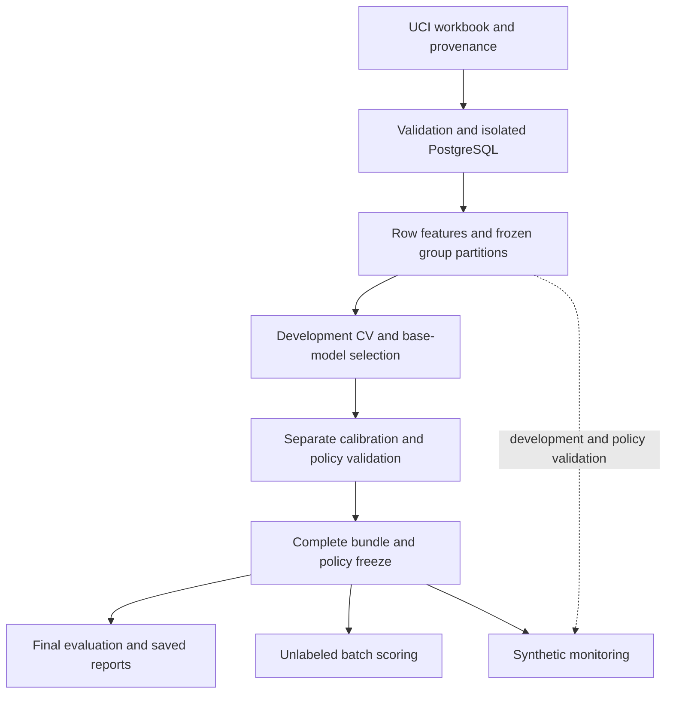

# Architecture

The project separates source validation, financial features, model selection,
probability assessment, hypothetical decisions, and saved-model scoring. The
prediction task is next-month default for existing accounts at a released
month-end snapshot; this is an educational benchmark, not a live lending service.

## Components and responsibilities

| Component | Responsibility | Boundary |
| --- | --- | --- |
| `data/`, `sql/`, `phase1.py` | Workbook interpretation, validation, transactional ingestion, curated tables, SQL/Python feature parity | Raw bytes remain immutable; invalid records are recorded, not silently dropped |
| `features/`, `splits/` | Versioned row arithmetic, financial fingerprints, four partitions and five development folds | Population-fitted statistics are excluded from the pre-split feature export |
| `models/`, `phase2.py`, `phase3.py` | Fold-fitted preprocessing, baseline comparison, bounded searches and development selection | Calibration, policy-validation and final-test outcomes do not select the base model |
| `models/calibration.py`, `decisioning/`, `phase4.py` | Fixed-base probability mappings, simulated utility, cutoff selection and freeze | Mapping fits use calibration; mapping/cutoff choices use policy validation |
| `explanations.py` | Logistic coefficients, raw-tree SHAP and descriptive slices | Development background and preselected validation cases; no causal interpretation |
| `models/bundle.py`, `phase5.py` | Hash guards, frozen final evaluation, paired group intervals and saved-evidence reporting | Final-test results do not replace the selected model or policy |
| `inference.py` | CSV/Parquet validation, exact saved-bundle loading and scored/quarantined reconciliation | Unlabeled inputs; no fitting or training-database dependency |
| `scoring.py`, `scoring_package.py` | Public package restoration, pinned integrity/runtime checks and explicit-location scoring | Separate delivery contract; no private payload or historical review dependencies |
| `monitoring.py` | Development-defined distributions, synthetic mix shifts and corruption checks | No observed temporal drift or automatic retraining |

Paths in this table are under `src/credit_risk/`, except repository-level `sql/`.
The existing phase modules are execution entry points; topic guides describe their
contracts without renaming the implementation.

## Delivered interfaces

The design's YAML command sketch and directory tree were proposed interfaces.
The delivered configuration is TOML, with stage-specific entry points and
`inference.py`, `monitoring.py` and `explanations.py` as modules.

| Delivered entry point | Responsibility | Required context |
| --- | --- | --- |
| `python -m credit_risk` | `validate`, `ingest`, `features`, `split`, `eda`, `reproduce`; baseline and `phase3-*` commands | TOML configuration, matching inputs and checkpoint provenance; ingestion needs the isolated database |
| `python -m credit_risk.phase4` | `integrity`, `run`, `resume`, `finalize` | Original development-model backup and phase configuration/receipts |
| `python -m credit_risk.phase5` | `preflight`, `evaluate`, `report`, `score`, `monitor` | Scoring uses the frozen payload; historical source-bound commands need the accepted-source archive |
| `python -m credit_risk.scoring` | `restore`, `verify`, `score` | Included public scoring package, pinned environment, explicit artifact/input/output paths and trust before model loading |
| `scripts/reproduce_phase5.py` | Validate data/features/splits and saved frozen evaluation | Historical source/payload, pinned environment and a new output directory |

The main module's `reproduce` covers the data workflow, not all five modeling
stages. The planned unified `train`/`calibrate`/`policy` commands are not aliases
for the delivered entry points. [Setup](setup.md) and [historical recipes](setup.md#historical-checkpoint-guides)
provide actual commands and dependencies.

No notebooks were delivered from the proposed layout; reusable Python modules,
CLI-generated reports and these guides provide the analysis. The optional UI,
inference endpoint, model registry and additional monitoring package were not
implemented. None is needed to interpret the frozen core study.

## Storage and lineage

PostgreSQL stores validated source, curated records and audit attributes in the
project's disposable development instance. Its identity is checked before writes.
The scorer reads a trusted local bundle and needs neither PostgreSQL nor labels.
MLflow records partition-named metrics, resolved parameters, content hashes,
runtime and model artifacts in local tracking stores; no cloud service is required.
Early execution records have null Git commits and use code/input/lock hashes;
later Git initialization does not retroactively give those runs a commit. The
publication history is separate from original scientific source identities.

| Location | Contents | Public-clone availability |
| --- | --- | --- |
| `src/`, `sql/`, `configs/`, `tests/` | Maintained implementation, configuration and synthetic fixtures | Included |
| `artifacts/` tracked files | Source/feature contracts, split assignments and compact provenance | Included |
| `reports/` | Aggregate comparisons, intervals, policy tables, figures and selected receipts | Included |
| `examples/` | Synthetic unlabeled input and previously verified output | Included |
| `bundles/` | Minimal fitted scoring package, checksum and separate delivery manifest | Prepared for repository inclusion; hosting pending |
| `data/raw/`, `data/processed/` | Workbook and customer-level exports | Separately preserved inputs |
| `artifacts/models/`, `artifacts/runtime/` | Frozen fitted bundle, required original evidence and saved evaluation | Separately supplied private payload |
| `mlruns/`, `.env`, `.venv/` | Local tracking, credentials and environment | Excluded |

The complete freeze binds preprocessing, class-1 probability mapping, schema,
reference models, policies, report definitions and original review evidence.
Presentation documents are not replacements for those hash-bound files.
Historical scientific receipts identify their original source rather than the
publication checkout's separate Git history.
The public distribution preserves the selected pipeline bytes and frozen decision
definitions, with separate file/content identities. It does not replace the
original complete freeze or claim to contain the full experiment history.

See [data contracts](data_contracts.md), [modeling](modeling.md),
[setup and reproduction](setup.md), and [testing and CI](ci_cd.md).
