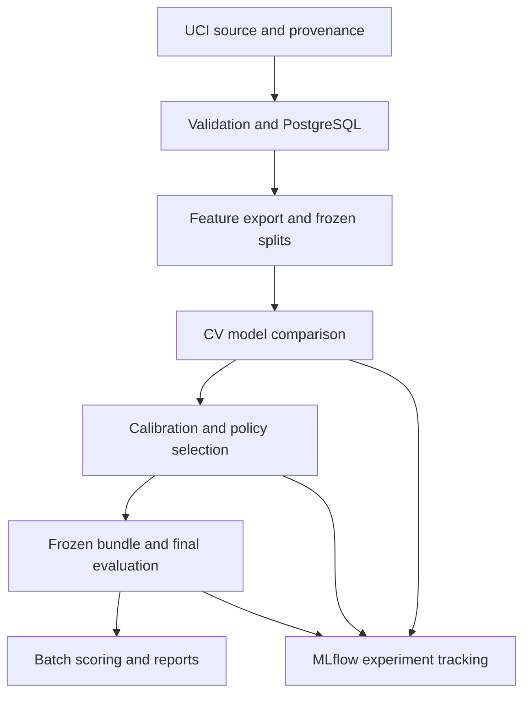

# Credit Risk & Lending Decision Science Platform

**Historical context.** This document records the original project design.
Planned requirements and the original repository layout are retained below.
For delivered behavior and documented deviations, use the [README](../README.md)
and maintained [architecture](architecture.md), [modeling](modeling.md),
[calibration and policies](calibration_policies.md) and
[batch scoring](batch_scoring.md) guides. The
[original implementation plan](archive/original_phase_plan.md) records the
historical delivery sequence.

## Project design document

**Version:** 1.0  
**Design date:** October 3, 2026  
**Repository name:** `credit-risk-decision-science`  
**Build window:** 5 weeks, with a sixth week for polish  
**Estimated effort:** 65–90 focused hours; allow additional time while learning the libraries  
**Primary objective:** Demonstrate an end-to-end supervised machine-learning workflow for an early-career Data Scientist portfolio.

This document is an implementation specification. Model scores, policy results, and performance improvements are intentionally left unclaimed until measured.

## 1. Executive overview

Build a reproducible system that estimates a customer's next-month default probability, compares interpretable and nonlinear models, evaluates probability calibration, and translates risk estimates into a transparent lending-policy simulation.

The central question is:

> How much does careful modeling improve risk ranking, probability estimates, and simulated decision value over simple baselines?

The project should show the reasoning behind each decision: what information was available, how leakage was prevented, which model generalized best, whether calibration helped, and how conclusions changed under different cost assumptions.

The recommended dataset contains **existing credit-card customers**, rather than new loan applications. Accordingly, the implemented prediction task is **month-end account risk assessment**. The lending component is an explicitly hypothetical policy simulation. It must not be presented as a validated loan-origination system.

The finished work should be useful to a reviewer in three ways:

1. A short README explains the problem, strongest findings, and limitations.
2. A results report demonstrates model evaluation and decision science.
3. A documented command sequence reproduces the pipeline and scores a new batch without retraining.

## 2. Portfolio purpose and boundaries

This project complements an existing portfolio of supply-chain analytics and forecasting, real-estate regression, and e-commerce experimentation. Its main contribution is credible evidence of predictive ML.

| Gap to address | Evidence this project should produce |
| --- | --- |
| scikit-learn workflows | Fitted `Pipeline` and `ColumnTransformer` objects; fold-safe preprocessing |
| Supervised classification | Dummy, logistic regression, random forest, and XGBoost comparisons |
| ML feature engineering | Defined financial-history features, edge-case tests, and an ablation experiment |
| Validation and tuning | Frozen splits, cross-validation, bounded randomized search, untouched final test |
| Class imbalance | Average precision, precision/recall analysis, weighting experiments |
| Probabilistic modeling | Log loss, Brier score, reliability diagrams, calibration comparison |
| Explainability | Logistic coefficients, SHAP analysis, and error case studies |
| Decision science | Cost-sensitive policies, uncertainty, and sensitivity analysis |
| Lightweight MLOps | MLflow tracking, versioned model bundle, batch inference, Docker, CI |
| Monitoring | Data-quality checks and explicitly simulated distribution-shift scenarios |

### Scope tiers

| Required for completion | Optional after the core passes | Outside this project |
| --- | --- | --- |
| Real public dataset and provenance | Small local presentation UI | Power BI/Tableau reporting suite |
| SQL-backed curated feature export | FastAPI inference endpoint | Unrelated application frameworks |
| Four baseline/candidate families | MLflow model registry | Deep learning or PyTorch |
| Calibration and policy simulation | Evidently monitoring report | Spark, Airflow, cloud warehouse |
| SHAP, uncertainty, model card | Additional model seeds | Kubernetes or live lending deployment |
| Batch scoring, tests, CI, Docker | Second dataset with genuine dated cohorts | Causal inference/reject inference |

Optional tools require a concrete modeling or reproducibility purpose. The deliverable is a modeling study supported by reproducible software.

## 3. Dataset decision

### 3.1 Primary source

Use **UCI Default of Credit Card Clients**, dataset ID **350**. UCI lists 30,000 observations, 23 explanatory variables, Taiwanese credit-card data, and a CC BY 4.0 license. Its financial histories cover April through September 2005. Credit the dataset creator, I-Cheng Yeh, and DOI `10.24432/C55S3H`. [1]

Download the original workbook from the official dataset page, or use the documented `ucimlrepo` import. Prefer the workbook if it preserves the customer identifier and readable field names more conveniently. Choose one canonical ingestion route and normalize its schema.

Preserve an immutable source copy locally, its SHA-256 checksum, source URL, retrieval timestamp, attribution, and import configuration. Git should contain the acquisition instructions and metadata; it need not contain the raw workbook.

### 3.2 Why this dataset

Thirty thousand rows are sufficient for a substantial local comparison of classification models and calibration methods. The dataset is accessible, supports a manageable CPU workflow, and provides financial histories that can motivate feature engineering.

The distinction from a basic benchmark project will come from validation, calibration, policy assumptions, uncertainty, reproducibility, and analysis of failure modes. Dataset size alone is not the distinguishing feature.

### 3.3 What the data cannot establish

The published schema supplies one customer snapshot with historical monthly fields, rather than independent origination cohorts spanning several years. Therefore:

- Do not split rows by customer ID and call it temporal validation.
- Do not turn the six history columns into six independently labeled training months. There is no corresponding target for each historical month.
- Do not invent application dates, salaries, loan interest rates, recoveries, or rejection outcomes.
- Do not claim applicability to contemporary Canadian lending.
- Do not interpret the target as lifetime loan default or a formally established 90-day regulatory default definition.

Use the released next-month default indicator as the target, and document any unresolved details of its operational definition during ingestion.

**Temporal validation is not a requirement for version 1 because this dataset cannot support it.** If a future dataset includes dated cohorts, redefine prediction time and outcome maturity before adopting chronological validation. That is a separate extension, not a prerequisite for this build.

## 4. Prediction and decision contracts

| Item | Definition |
| --- | --- |
| Unit of observation | One existing credit-card customer at the released month-end snapshot |
| Prediction time | After all released September history fields are available; this is a retrospective availability assumption |
| Horizon | Next month, according to the released target |
| Positive label | `default_next_month = 1` |
| Prediction output | `p_default`, a number between 0 and 1 |
| Primary population | Existing accounts represented in the historical dataset |
| Decision output | `accept_simulated` or `abstain_simulated`, under a named payoff scenario |
| Intended use | Educational model evaluation and hypothetical lending-policy comparison |
| Actual lending action | None |

The model estimates outcomes in the observed population. It does not establish how a customer would behave after receiving additional credit, being declined, or receiving an intervention.

The policy simulator applies a payoff table to observed labels under explicit assumptions. Its value is a **benchmark utility**, not measured profit, incremental revenue, avoided loss, or a causal policy effect.

## 5. System architecture



### Stack

| Layer | Choice | Purpose |
| --- | --- | --- |
| Runtime | Python 3.12 as the initial compatibility target | Stable local environment; confirm package compatibility before locking |
| Data work | Pandas, NumPy, PostgreSQL, SQLAlchemy/psycopg | Ingestion, checks, SQL feature export |
| Modeling | scikit-learn, XGBoost | Pipelines, baselines, tuning, classification |
| Interpretation | SHAP, Matplotlib | Model explanations and report figures |
| Tracking | MLflow | Parameters, metrics, data fingerprints, artifacts |
| Packaging | `pyproject.toml`, committed dependency lock | Repeatable setup |
| Verification | pytest, Ruff, GitHub Actions | Behavioral checks and code quality |
| Execution | Docker and Docker Compose | Local PostgreSQL and reproducible pipeline execution |

Python 3.12 is a project environment choice, not a request to replace an existing system Python. Create a separate environment or use the container. Pin working package versions after a small import/train/serialize smoke test; do not assume the latest versions are mutually compatible.

Use one PostgreSQL service. MLflow can use a local SQLite backend and local artifact directory. An always-running tracking server and registry are optional.

## 6. Data contracts and SQL layer

### 6.1 Logical datasets

| Dataset/table | Grain and key | Contract |
| --- | --- | --- |
| `raw.credit_clients` | One source record; `client_id` | Preserve source values and source checksum |
| `curated.credit_clients` | One validated customer; `client_id` | Canonical names/types; cleaning flags; no silent row loss |
| `curated.model_features_v1` | One customer; `client_id` | Explicit predictor allowlist; deterministic row-level features |
| `curated.audit_attributes` | One customer; `client_id` | Demographic fields for descriptive slice analysis only |
| `artifacts/split_manifest.csv` | One customer assignment | Split, fold, fingerprint, seed, source hash |
| Batch score output | One input row; `record_id` | Risk probability, policy result, bundle/scenario versions |

Store the target separately from the inference feature contract. Training exports may join features to labels by key, but the scorer must reject the target as an input predictor.

PostgreSQL is used for validated data and a concise SQL feature-export layer. Use explicit column lists and versioned SQL. No dbt project or orchestration framework is necessary here.

### 6.2 Validation behavior

- Require unique, non-null identifiers, expected columns, and a binary non-null target in the training source.
- Reconcile source, curated, excluded, and exported row counts.
- Check numeric conversion, finite values, and positive credit limits.
- Preserve negative bill balances unless evidence establishes corruption. Do not convert legitimate signed amounts to zero by default.
- Profile every categorical code. Map undocumented demographic codes to explicit `unknown` groups for audit reporting.
- Preserve special repayment-status codes as categories; do not casually reinterpret every nonpositive code as the same behavior.
- Keep a cleaning ledger with counts, reason codes, and before/after examples.
- Fail ingestion on unexpected schema changes. Quarantine invalid records with reasons rather than silently dropping them.

Inspect exact duplicates separately from identical financial profiles. Different customer IDs can legitimately have identical predictor values. Do not delete these observations merely because features match.

### 6.3 Idempotency and provenance

Reingesting the same source hash must not append duplicate customers. Use a local transaction and an explicit development rebuild/upsert strategy. Log the row-count reconciliation and retain the immutable original file.

Any corrected source, revised cleaning rule, or changed feature contract requires a new dataset/feature version. Never overwrite the metadata for a previously reported experiment.

## 7. Feature availability and engineering

### 7.1 Predictor allowlist

Start with the released credit limit and repayment, bill, and payment histories. Treat these as available only at the specified month-end prediction time. A credit limit reflects an upstream lending policy and should not be described as an intrinsic customer trait.

Exclude `ID` and the target. Keep sex, age, education, and marital status outside the primary predictive feature set; retain them in a separate audit table. This is a scope choice for a behavior-focused portfolio model, not proof that the model is fair.

Create `docs/leakage_audit.md` with one row per input or derived feature:

| Required field | Meaning |
| --- | --- |
| Source columns | Exact raw dependencies |
| Availability | Why it exists by the prediction timestamp |
| Transformation | Formula, encoding, or learned operation |
| Fit scope | Row-only, fold training data, calibration partition, etc. |
| Decision | Include, audit only, exclude, or unresolved |
| Evidence/limitation | Source documentation or explicit assumption |

### 7.2 History alignment

Normalize the six months into an explicit April-to-September ordering. The source naming is irregular: September repayment status is `PAY_0`, followed by `PAY_2` through `PAY_6`. Bill and payment sequences use numbered fields. Verify the field-to-month mapping once and test it. [1]

Do not assume that a month's payment divided by the same month's bill is a contractual repayment fraction. Billing/payment timing and minimum payment obligations are not fully specified. Any such feature must be labeled as a proxy.

### 7.3 Initial engineered features

Keep the first feature set to roughly 10–15 derived variables in addition to raw financial fields.

| Feature | Proposed definition | Edge-case rule |
| --- | --- | --- |
| Recent delinquency count | Number of history statuses greater than zero | Special nonpositive statuses remain distinct in raw encoding |
| Maximum positive delay | Maximum of positive delay values, otherwise zero | Do not treat special codes as negative delay lengths |
| Recent/history delay contrast | Positive-delay summary in recent three months minus prior three | Explicit month mapping |
| Latest utilization proxy | Latest bill balance divided by credit limit | Signed ratio; no arbitrary clipping in the canonical export |
| Mean utilization proxy | Mean six-month bill balance divided by limit | Finite positive denominator required |
| Bill-balance change | Latest minus oldest bill balance, scaled by limit | Signed value |
| Bill volatility proxy | Population standard deviation of six bill balances divided by limit | Zero for constant history |
| Mean payment | Mean of six payment amounts | Preserve source units |
| Zero-payment count | Number of zero payment amounts | Zero is a value, not automatically missing |
| Payment-to-prior-bill proxy | September payment divided by positive August bill | Missing plus indicator when denominator is nonpositive |
| Aggregate payment/balance proxy | Total payments divided by total positive bill balances | Missing plus indicator if denominator is zero |

Do not create income, debt-to-income, employment-length, credit-score, or loan-purpose features: the selected dataset does not provide those fields.

### 7.4 Preprocessing

For logistic regression, use a `ColumnTransformer`: numeric imputation and scaling; categorical imputation and one-hot encoding with unknown-category handling. Encode repayment statuses categorically in the primary comparison, since special codes complicate a simple ordinal interpretation.

For tree models, use a compatible numeric/categorical transformation without unnecessary scaling. Keep encoded feature names for explanations. Where a proxy can be undefined, retain the missingness indicator and fit imputation within the training fold.

Deterministic within-row formulas can run before splitting. Imputation, scaling, category learning, feature selection, and any distribution-based cutoffs must be fitted within training folds. Pipelines help enforce this separation. [2]

### 7.5 Required ablation

Compare raw financial predictors against raw plus engineered predictors using the same development folds and search budget. Report whether feature engineering improved the selected validation metrics. Preserve an honest result if it did not.

## 8. Split strategy and leakage controls

### 8.1 Four disjoint partitions

Freeze the assignment before model-oriented EDA. Use target stratification and seed `42`.

| Partition | Target fraction | Approximate count before exclusions/group constraints | Permitted use |
| --- | ---: | ---: | --- |
| Development | 60% | 18,000 | EDA, feature experiments, CV, tuning, base-model selection |
| Calibration | 15% | 4,500 | Fit sigmoid and isotonic mappings for the frozen base model |
| Policy validation | 10% | 3,000 | Select calibration variant and policy settings |
| Final test | 15% | 4,500 | Evaluate frozen candidates and policies once |

These are design targets, not guaranteed counts. Report actual counts and class proportions after exclusions and group-aware allocation.

Use a fingerprint of the primary raw predictor allowlist to identify exact feature-profile matches. Keep matching profiles in the same partition and CV fold as a conservative memorization control, without deleting them. Do not include the target in the fingerprint. Use stratified group-aware splitting/folds, documenting any deviation from target fractions.

Primary EDA is performed on development data. Schema and identifier checks may cover the full source, but test distributions, labels, charts, and example cases must not influence development choices.

### 8.2 Selection sequence

1. Fix split manifest and five development CV folds.
2. Compare feature sets and model configurations within development CV.
3. Select the base model using the predefined rule in Section 9.
4. Fit that base pipeline on the complete development partition.
5. Fit candidate calibration mappings on the calibration partition only.
6. Choose raw/sigmoid/isotonic probabilities on policy validation.
7. Choose policy thresholds on policy validation under frozen scenarios.
8. Freeze the model, calibration variant, policy, feature schema, and metadata.
9. Evaluate the final test and publish both positive and negative findings.

Do not refit the base model on calibration or policy-validation rows after selecting its calibrator. That changes the score distribution the calibrator was fitted to. A future full-data refit is a separate bundle and cannot inherit the original held-out result without qualification.

If test results lead to new development, record the test exposure. Further use of that partition is exploratory; do not keep calling it an untouched test.

## 9. Modeling and bounded experimentation

### 9.1 Model progression

| Model | Role | Main question |
| --- | --- | --- |
| `DummyClassifier(strategy="prior")` | Constant probability baseline | Does the model beat the development default prevalence? |
| Majority-class prediction | Hard classification reference | Why can accuracy look good while identifying no defaults? |
| Regularized logistic regression | Interpretable baseline | How far can a simple model go? |
| Random forest | Nonlinear reference | Do interactions and nonlinear splits help? |
| XGBoost | Boosted-tree candidate | Does boosting improve enough to justify complexity? |

A majority classifier alone is a poor probability baseline. Use the constant-prior dummy for Brier score/log loss and the majority prediction only to illustrate threshold-dependent classification behavior.

### 9.2 Search budget

Use `RandomizedSearchCV` with fixed folds and `scoring="average_precision"`. Run an initial smoke search, then a bounded final search. [3]

| Family | Initial final-search ceiling | Parameters |
| --- | ---: | --- |
| Logistic regression | 12 configurations × 5 folds | Regularization strength; no weighting versus balanced weighting |
| Random forest | 15 configurations × 5 folds | Tree count, depth, minimum leaf size, feature sampling, weighting |
| XGBoost | 25 configurations × 5 folds | Tree count, depth, learning rate, subsampling, column sampling, child weight, L1/L2 penalties, class weighting |

These are compute limits, not minimum requirements. Profile a few fits first. Limit CPU concurrency so parallel CV workers and tree-library threads do not oversubscribe the machine. A CPU-only laptop should be enough; GPU/cloud spending is unnecessary for version 1.

Start without resampling. Compare unweighted models against fold-local class weights. Any `scale_pos_weight` ratio must be computed from the corresponding fit rows. Class weighting can affect probabilities, so assess calibration afterward.

Do not introduce SMOTE as a default. If tried later, use an imbalanced-learn pipeline and apply it only within training folds.

### 9.3 XGBoost early stopping

For the required search, tune a bounded `n_estimators` and omit early stopping. This is simpler and avoids evaluation-set handling errors.

An optional experiment may use early stopping, but it needs an inner holdout within each CV training fold. Fit preprocessing on that inner training set, transform the inner holdout, use it for stopping, then assess on the untouched outer fold. Never pass one global validation/test set to every fit in a CV search. XGBoost requires explicit evaluation data for early stopping; a generic pipeline does not automatically solve this routing. [4]

### 9.4 Predefined base-model rule

- Rank candidate configurations by mean development CV average precision.
- Define models within **0.01 absolute AP** of the highest mean as practically close for this project. This is a declared tolerance, not a statistical significance test.
- Among those, prefer lower CV log loss; if differences are small, prefer simplicity and faster inference, with logistic regression favored over a more complex model.
- Report fold variation, search budget, and the rule's effect on selection.

CV results guide selection and can be optimistic after extensive tuning. The final test is the independent report of the frozen choice. XGBoost is a required candidate, not a required winner.

## 10. Evaluation and calibration

### 10.1 Metric definitions

| Dimension | Metrics/output | Interpretation |
| --- | --- | --- |
| Ranking | Average precision (AP), ROC-AUC | Separation of defaults and nondefaults |
| Probability quality | Log loss, Brier score | Penalize inaccurate probability estimates |
| Calibration diagnostics | Reliability diagram with bin counts; predicted versus observed rate | Whether predicted risk corresponds to observed frequency |
| Decision behavior | Precision, recall, F1, confusion matrix at declared threshold | Consequences of classifying high-risk customers |
| Policy outcomes | Acceptance rate, accepted observed default rate, simulated utility | Tradeoffs under assumed payoffs |
| Engineering | Fit time, scoring throughput, bundle size | Cost and reproducibility of the approach |

Use **average precision** consistently. Do not label it as trapezoidal PR-AUC without specifying the estimator. Accuracy may appear in an appendix but must not be the headline result. The metric implementation must specify positive class `1`. [5]

### 10.2 Calibration comparison

For the selected base model, compare raw probabilities, sigmoid calibration, and isotonic calibration. Fit both mappings on calibration rows excluded from base-model fitting. The exact scikit-learn API should follow the pinned release; when applicable, wrap the fitted estimator with `FrozenEstimator` rather than retraining it on the calibration set. [6]

Select the probability variant using policy-validation log loss. Within an absolute difference of **0.005**, prefer the simpler mapping: raw, then sigmoid, then isotonic. Show Brier score and reliability diagrams as supporting evidence.

Brier score and log loss assess overall probabilistic quality, not calibration alone. Isotonic is not automatically better and can change rankings through tied scores. A valid conclusion is that calibration provided no improvement.

Use fixed equal-width bins for cross-model reliability comparisons and show their counts. Sparse bins should be visibly marked rather than treated as strong evidence of miscalibration.

### 10.3 Final-test reporting

Evaluate all frozen base-model finalists for context, plus the selected probability bundle and policies. Do not change the champion because another candidate wins on the test.

Use 1,000 fixed-seed bootstrap repetitions for 95% percentile intervals for AP, ROC-AUC, Brier score, and differences between policies/models. Use paired resampling when comparing the same rows. Resample fingerprint groups if group constraints were used. Handle one-class or empty-accepted-set replicates explicitly.

These intervals describe evaluation-sample uncertainty conditional on fitted models. They do not include every source of model-development uncertainty or prove temporal robustness.

## 11. Lending-policy simulation

### 11.1 Explicit payoff model

Define hypothetical action `accept_simulated` as allocating one standardized exposure unit and `abstain_simulated` as allocating none. Use the observed next-month label as the benchmark outcome, assuming it is unchanged by the hypothetical allocation.

For customer `i`:

\[
EU_i(accept)=(1-p_i)G_i-p_iL_i-C_i
\]

\[
EU_i(abstain)=0
\]

`G` is net gain for a nondefault, `L` is net loss for a default, and `C` is a processing cost for every accepted account. Define these consistently so principal, recovery, or costs are not counted twice.

Accept when expected utility is positive. With constant payoffs, the break-even threshold is:

\[
p_i < \frac{G-C}{G+L}
\]

If `G <= C`, accept none. Validate payoff inputs and define ties as abstentions.

### 11.2 Base assumptions

Use **dimensionless utility units**, not reported dollars. Version 1 uses the same hypothetical exposure per customer; it does not equate a historical credit limit or bill balance with exposure on a new loan.

| Assumption | Base value | Status |
| --- | ---: | --- |
| Standardized exposure | 1,000 units | Synthetic |
| Nondefault net gain `G` | 50 units | Synthetic |
| Default net loss `L` | 500 units | Synthetic |
| Processing cost `C` | 0 units | Synthetic |
| Analytic probability threshold | 50 / 550 ≈ 0.0909 | Derived from assumptions |

The payoff horizon is the released next-month outcome. This is not an estimated APR, full-loan cash-flow model, or loss-given-default model fitted from data.

### 11.3 Policies to compare

1. Accept all.
2. Abstain on all.
3. Accept a fixed low-risk fraction: 25%, 50%, and 75%.
4. Accept when predicted default probability is below 0.5, as a conventional reference.
5. Accept below the analytic expected-utility threshold.
6. Accept below a threshold selected on policy validation to maximize benchmark utility.

For policy 3, derive numerical score cutoffs on policy-validation rows and freeze them; the achieved test acceptance rate may differ. Resolve tied scores with a documented deterministic rule.

For policy 6, use a fixed grid from 0 to 1 in steps of 0.005, plus explicit accept-all/none policies. Freeze the selected cutoff. Break utility ties by choosing the lower acceptance rate. Do not optimize it on test labels.

Define label-based benchmark utility as:

\[
U = \sum_i a_i\big[(1-y_i)G_i-y_iL_i-C_i\big]
\]

Report total and per-customer utility, mean predicted expected utility, acceptance rate, accepted count, accepted default rate, and high-risk detection metrics. When no customers are accepted, default rate is `N/A`, not zero.

If abstaining on every account wins under a scenario, publish that result. Do not weaken costs or tune the test threshold to force an appealing outcome.

### 11.4 Sensitivity analysis

Predefine a 3 × 3 grid: gains of 25/50/100 and losses of 250/500/750, with processing cost zero. Add a processing-cost scenario of 5 units as a secondary check.

Recalculate analytic thresholds per scenario. If empirical thresholds are compared, select each one on policy validation, then freeze them before test evaluation. Publish the full grid rather than only favorable cells.

The report must say that allocation utility is hypothetical. Historical outcomes for existing accounts do not identify outcomes for rejected applicants or customers exposed to a changed lending policy.

## 12. Explainability and error analysis

### Required analyses

- Standardized numeric logistic coefficients and selected categorical contrasts, with their reference levels.
- Global SHAP summary for the best development-selected tree candidate.
- Two SHAP dependence plots chosen on development data.
- Four local examples chosen on policy validation: a confident correct default, a confident correct nondefault, a missed default, and a false alarm.
- Error rates by declared behavioral slices: delinquency history and development-defined utilization bands.

Use a fixed development background sample for SHAP, cap the explained sample at around 1,000 rows, and save explainer settings and feature names. Explicitly state whether values explain raw model margin/log-odds or probability. TreeExplainer's output options and assumptions should follow the pinned release. [7]

**SHAP explains model behavior, not causation.** Correlated histories can share attribution. If a tree candidate is not the champion, explain it as a challenger and do not imply its SHAP values explain the selected logistic model. Similarly, raw-tree explanations do not automatically explain a post-calibration probability mapping.

### Descriptive demographic audit

Report sample counts, target prevalence, average predicted risk, and, where supported, recall/false-positive rate/calibration by the audit attributes. Suppress unstable summaries for slices with fewer than 100 rows or 20 examples of either class. These cutoffs are project reporting choices.

Do not optimize separate demographic thresholds. Removing demographics from predictors does not remove proxies or establish fairness. Keep this analysis descriptive and scoped to the historical sample.

## 13. Monitoring and simulated shift

There is no live production stream or genuine later cohort in version 1. Build a monitoring component and demonstrate it on **synthetic scenarios** derived from policy-validation data. Do not label them observed temporal drift.

### Scenarios

| Scenario | Construction | What it tests |
| --- | --- | --- |
| Reference | Original policy-validation sample | Baseline report |
| Financial mix shift | Reweight/resample toward an existing high-utilization subgroup | Distribution changes without editing labels |
| Delinquency mix shift | Reweight/resample toward customers with positive delays | Changed population composition |
| Data corruption | Inject missing fields, nonnumeric amounts, unseen categories | Validation and inference behavior |

Use fixed seeds and record sampling weights and altered counts. Feature corruption tests should measure data-quality and prediction behavior; do not attach original labels to materially edited financial histories and treat resulting accuracy as genuine performance.

### Monitoring outputs

- Schema validity, missingness, unknown-category rate, record counts.
- Numeric distributions and predicted-risk distribution.
- PSI using development-defined bins with explicit underflow/overflow bins and epsilon handling; optionally a second distribution-distance statistic.
- Labeled metrics when outcomes are actually available in the resampled scenarios.
- Warning summaries with configurable demonstration thresholds.

PSI is a distribution diagnostic, not proof of concept drift. Thresholds are configurable heuristics rather than universal rules. When labels are absent, report feature/prediction shift only; do not infer performance deterioration.

No automatic retraining is required. A monitoring warning should produce a review recommendation and report, not silently replace the champion.

## 14. Experiment tracking and model packaging

Use MLflow for experiments from the baseline phase onward. MLflow supports logging parameters, metrics, code information, and artifacts in grouped runs. [8]

Log:

- Model family and full resolved parameters.
- Source checksum, split-manifest hash, feature version, seed, and Git commit.
- Environment lock hash and training/calibration row counts.
- Fold metrics and mean/variation; partition name on every metric.
- Calibration choice and selection rationale.
- Policy-scenario configuration and selected thresholds.
- Runtime, key charts, search-results table, fitted pipeline, and model metadata.

Track the base model and calibrated bundle as distinct artifacts. The chosen bundle must package preprocessing, probability mapping, schema, and policy metadata together.

### Bundle contract

| File/content | Requirement |
| --- | --- |
| Fitted pipeline/model | Transform and score without fitting |
| Calibration object | Included only when selected |
| `feature_schema.json` | Required fields, types, unknown/missing handling |
| `model_metadata.json` | Version, training source, split hash, commit, positive class |
| `policy.json` | Payoffs, cutoffs, tie rules, scenario IDs |
| `model_card.md` | Population, task, results, limitations |

Load only locally produced trusted serialized artifacts. Keep large model files and MLflow runtime directories out of normal Git history. Commit compact CSV/JSON results and readable report figures.

## 15. Batch inference and reproducibility

The minimum interface is a CLI that reads a CSV/Parquet batch and outputs:

| Field | Meaning |
| --- | --- |
| `record_id` | Input identifier preserved for reconciliation |
| `p_default` | Selected bundle's probability for positive class 1 |
| `decision_simulated` | Result of the named policy |
| `expected_utility` | Predicted utility under the configured scenario |
| `model_version` | Exact bundle version |
| `scenario_id` | Exact payoff/policy version |
| `validation_status` | Valid or quarantined, with reason |

The scorer must not need labels, fit preprocessing, or retrieve the training database. Inputs with fatal schema errors fail before scoring; row-specific errors produce a separate rejected-row file. Output counts must reconcile with inputs.

### Planned command interface

These commands are **interfaces to implement**, not existing commands:

```bash
python -m credit_risk ingest --config configs/base.yaml
python -m credit_risk validate --config configs/base.yaml
python -m credit_risk features --config configs/base.yaml
python -m credit_risk split --config configs/base.yaml
python -m credit_risk train --config configs/base.yaml
python -m credit_risk calibrate --config configs/base.yaml
python -m credit_risk policy --config configs/base.yaml
python -m credit_risk evaluate --partition test --bundle artifacts/champion
python -m credit_risk score --input examples/scoring_batch.csv --bundle artifacts/champion
python -m credit_risk monitor --scenario financial_mix_shift
```

Implement a `reproduce` entry point or documented runner to execute the required stages in order. It must refuse stale split/model dependencies and preserve stage metadata. A fresh-container reproduction should produce the same split assignment and close numerical results within a documented tolerance.

Provide a small labeled synthetic fixture for CI and an **unlabeled** illustrative batch for the scorer. These are software fixtures; never mix them into reported real-data training or evaluation.

## 16. Repository layout

```text
credit-risk-decision-science/
  README.md
  Credit-Risk-Design.md
  pyproject.toml
  <dependency-lock-file>
  Dockerfile
  compose.yaml
  .env.example
  .gitignore
  configs/
    base.yaml
    smoke.yaml
    policy_scenarios.yaml
  src/credit_risk/
    __main__.py
    data/                 # acquire, ingest, validate, provenance
    features/             # row formulas and preprocessing
    splits/               # grouping, partitions, manifest
    models/               # baseline, train, calibrate, evaluate
    decisioning/          # payoff math, policy comparison
    monitoring/           # distributions and scenario generation
    inference/            # bundle loading and batch scoring
    reporting/            # tables and figures
  sql/
    001_schema.sql
    002_curated.sql
    003_feature_export.sql
  notebooks/
    01_development_eda.ipynb
    02_model_diagnostics.ipynb
    03_explanations.ipynb
  tests/
    fixtures/
  examples/
    scoring_batch.csv
  data/
    README.md
    raw/                  # ignored
    processed/            # ignored
  artifacts/              # runtime models ignored; manifests versioned
  reports/
    model_comparison.csv
    calibration_comparison.csv
    policy_comparison.csv
    figures/
    results.md
  docs/
    data_contracts.md
    leakage_audit.md
    methodology.md
    model_card.md
    reproduction.md
    decision-log.md
  .github/workflows/ci.yml
```

Choose the lock-file name according to the package manager selected in week 1. Do not create redundant `requirements.txt`, lock files, and manually conflicting dependency specifications.

Notebooks explain and explore. Reusable transformations, model training, metric calculations, and scoring belong in `src/`, and notebooks call those functions.

## 17. Verification strategy

Focus tests on failure modes that would invalidate scientific results or scoring behavior.

| Area | Required evidence |
| --- | --- |
| Data | Unique IDs; binary target; ingestion idempotency; row reconciliation |
| Feature calculations | Known month order; special status codes; negative balances; zero/nonpositive denominator behavior |
| Split safety | Disjoint IDs/groups; complete assignment; stable seed; correct CV membership |
| Leakage | Target/ID/audit fields excluded; held-out sentinel values cannot change fitted imputation/scaling |
| Calibration | Base fit, calibrator fit, validation, and test rows disjoint |
| Policy math | Analytic threshold agrees with utility sign; ties; accept-all/none; invalid payoff inputs |
| Metrics | Positive class mapping; AP implementation; empty acceptance; undefined one-class metrics |
| Inference | Serialization round trip; batch/single prediction agreement; unknown categories; missing schema failure |
| Pipeline | Small fixture runs through training, calibration, policy, bundle load, and score |

CI runs linting and fixture-based tests. It should not download the real dataset, run a full randomized search, or require private cloud credentials.

Full-data checks run locally: data reconciliation, split validation, bounded training, final report generation, and a fresh-container reproduction. Use GitHub Actions services only if a small SQL integration test requires PostgreSQL.

The final-test run requires frozen metadata to exist; it must record the bundle and policy versions used. Repeated execution of an unchanged frozen evaluation is acceptable for reproducibility, but using its results to tune is not.

## 18. Five-week delivery plan

### Week 1: contracts, data, and leakage audit — 12–16 hours

1. Verify download, attribution, identifiers, target, special codes, and history mapping.
2. Create project environment, provenance manifest, and concise data dictionary.
3. Implement ingestion, validation, SQL export, and row reconciliation.
4. Freeze partition/fold manifests before modeling EDA.
5. Complete development-only EDA and leakage audit.

**Exit gate:** Source-to-export counts reconcile; target and prediction time are documented; test is sealed; schema/feature/split tests pass. Resolve any uncertain predictor before training rather than assuming it is safe.

### Week 2: pipelines and interpretable baselines — 12–16 hours

1. Implement dummy, logistic regression, and random forest pipelines.
2. Establish fold-wise AP, ROC-AUC, log loss, and Brier score.
3. Add MLflow tracking and experiment metadata.
4. Compare raw versus engineered features and weighted versus unweighted fits.
5. Inspect development errors and convergence/runtime issues.

**Exit gate:** Baselines run from the CLI; preprocessing is fold-safe; model comparison has real measurements and no test metrics.

### Week 3: XGBoost and model selection — 14–18 hours

1. Implement a small XGBoost smoke search.
2. Run the bounded family searches under fixed folds.
3. Produce the feature ablation and CV comparison report.
4. Select and fit the base model using the predefined rule.
5. Record champion/challenger rationale, including any near ties.

**Exit gate:** Base model is selected from development evidence; search budgets and feature versions are recorded; the fitted development-only bundle exists.

### Week 4: calibration, policy, and explanations — 14–18 hours

1. Fit raw/sigmoid/isotonic probability variants using the prescribed partitions.
2. Select the probability variant on policy validation.
3. Implement analytic and empirically selected policy thresholds.
4. Run the predefined utility sensitivity grid.
5. Produce SHAP, local error cases, and descriptive slice analysis.
6. Freeze the complete champion, reference candidates, and policy metadata.

**Exit gate:** No calibration or policy step uses test data; policies and assumptions are reproducible; explanations identify the exact model/output they explain.

### Week 5: final evaluation, monitoring, and reproduction — 13–18 hours

1. Evaluate the frozen test once and generate uncertainty intervals.
2. Build batch inference and save/load verification.
3. Demonstrate simulated mix shifts and corruption handling.
4. Complete Docker, CI, and a fresh-environment reproduction.
5. Write the model card, results report, README, and limitations.

**Exit gate:** Core acceptance checklist passes; a reviewer can reproduce and score a batch; all reported results are traceable to frozen artifacts.

### Optional week 6: presentation and learning consolidation

Polish figures, simplify the README, record a short walkthrough, and practice explaining model/calibration/policy tradeoffs. Add a small UI or inference API only if the modeling report and reproducibility are already complete.

If time runs short, reduce search counts and omit optional interfaces. Preserve the independent test, calibration separation, policy assumptions, and clear reporting.

## 19. Results and portfolio deliverables

### Minimum report tables

1. Source-to-curated row reconciliation and cleaning ledger.
2. Split sizes, class proportions, and fingerprint-group counts.
3. Development CV model comparison with search budget and runtime.
4. Raw-versus-engineered feature ablation.
5. Policy-validation calibration comparison.
6. Frozen final-test results with confidence intervals.
7. Policy comparisons and payoff sensitivity grid.
8. Simulated monitoring scenario summary.

### Minimum figures

- Precision–recall curves for frozen candidates.
- Reliability diagram with bin counts.
- Confusion matrix at the declared selected risk threshold.
- Policy acceptance versus utility plot, clearly identifying validation versus test.
- Utility sensitivity heatmap.
- SHAP summary and selected local/dependence plots.
- Reference versus synthetic-shift distributions.

### README first-screen content

State the task and dataset, show three measured takeaways, link the main results/model card, and provide reproduction instructions. Identify the synthetic payoff assumptions near the policy findings, rather than burying them in an appendix.

The model card should state population, prediction time, target definition, feature exclusions, split method, chosen model/calibration, held-out metrics, utility assumptions, demographic audit limits, and lack of temporal/external validation.


## 20. Completion checklist

- [ ] Dataset source, attribution, checksum, and schema are documented.
- [ ] The task is existing-account next-month risk, with explicit availability assumptions.
- [ ] Source, curated, rejected, and exported counts reconcile.
- [ ] ID, target, and audit-only columns are excluded from prediction.
- [ ] Four partitions and development folds are frozen and disjoint.
- [ ] Learned preprocessing is fitted only on appropriate training rows.
- [ ] Dummy, logistic regression, random forest, and XGBoost are evaluated.
- [ ] A bounded search and feature ablation are reported.
- [ ] Model selection follows the declared development rule.
- [ ] Calibration fit and calibration selection use separate partitions.
- [ ] Payoffs, policies, thresholds, and tie rules are frozen before test evaluation.
- [ ] Final-test metrics and paired uncertainty estimates are published honestly.
- [ ] SHAP identifies its explained model/output and avoids causal claims.
- [ ] Utility results are explicitly hypothetical and sensitivity-tested.
- [ ] Monitoring scenarios are labeled synthetic; no temporal drift claim is made.
- [ ] A saved bundle scores an unlabeled batch without fitting or database access.
- [ ] Behavioral tests, CI, and fresh-container reproduction pass.
- [ ] README, results, leakage audit, model card, and reproduction guide are complete.

No minimum AUC or XGBoost-win requirement defines success. A transparent, reproducible finding that a simpler model performs similarly is a strong outcome. Failure to beat the dummy should trigger a pipeline/label audit and an honest report, not fabricated performance.

## 21. First implementation milestone

The first work session should stop at a verified project skeleton and data contract:

1. Place this document at the repository root.
2. Create the isolated Python environment and dependency configuration.
3. Acquire the dataset and preserve its original bytes and metadata.
4. Produce a schema profile, field-to-month mapping, target checks, and code inventory.
5. Draft the leakage audit and data contract.
6. Implement ingestion validation and deterministic split-manifest generation.

Do not start model tuning, a dashboard, cloud deployment, or an API in this milestone. Its output is the evidence that the subsequent experiment is well-defined.

## 22. Primary references

Sources were checked while preparing this design. Library APIs should follow the project's pinned versions rather than assuming the linked `stable` documentation remains identical.

1. **UCI dataset, metadata, acquisition, and license:** [Default of Credit Card Clients](https://archive.ics.uci.edu/dataset/350/default+of+credit+card+clients). Dataset citation: Yeh, I. (2009), DOI [10.24432/C55S3H](https://doi.org/10.24432/C55S3H). Attribution/license information must accompany redistributed data or derived datasets.
2. **Leakage and preprocessing:** [scikit-learn: Common pitfalls and recommended practices](https://scikit-learn.org/stable/common_pitfalls.html).
3. **Search API:** [scikit-learn: RandomizedSearchCV](https://scikit-learn.org/stable/modules/generated/sklearn.model_selection.RandomizedSearchCV.html).
4. **Evaluation-set handling:** [XGBoost: Using the scikit-learn estimator interface](https://xgboost.readthedocs.io/en/stable/python/sklearn_estimator.html).
5. **Metrics and scoring:** [scikit-learn: Model evaluation](https://scikit-learn.org/stable/modules/model_evaluation.html).
6. **Independent calibration and probability diagnostics:** [scikit-learn: Probability calibration](https://scikit-learn.org/stable/modules/calibration.html).
7. **Tree explanation settings:** [SHAP: TreeExplainer](https://shap.readthedocs.io/en/latest/generated/shap.TreeExplainer.html).
8. **Tracking metadata and artifacts:** [MLflow: ML experiment tracking](https://mlflow.org/docs/latest/ml/tracking/).

The split proportions, search budgets, selection tolerances, cost scenarios, and reporting cutoffs in this document are project design decisions. They are not attributed to these sources or presented as industry-wide requirements.
