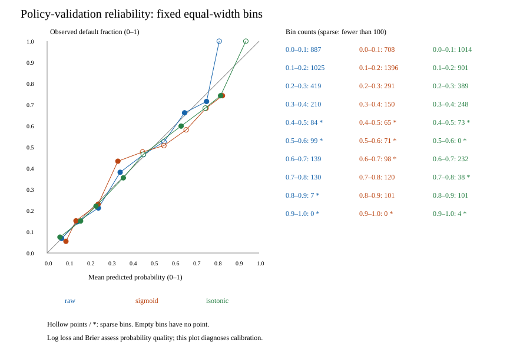

# Phase 4: probability calibration and hypothetical allocation policies

**Phase 4 exit gate: PASS. The complete pre-test bundle is frozen and independently reviewed.** Calibration, policy selection, sensitivity, logistic interpretation, descriptive slices, durable serialization and all required real-data SHAP artifacts have supporting evidence. Final-test outcomes have not been evaluated; Phase 5 remains unstarted.

## Fixed identities and permitted evidence

Phase 4 MLflow run: `9ca62eca2665438c9c97b4889413acfa` (FINISHED for completed core work). The selected base remains `xgboost_05_engineered_none`, accepted Phase 3 selection `6a0725d18b164582938e0b07b2df6b27`, binary SHA `265db2cbe02e88ca7c75c29f39b5c0230a29ba40e4735ea808aea08df4a5e83c`. All four accepted fitted references are preserved unchanged. No base/reference retraining, tuning, or reselection occurred.

The official UCI 350 task is existing-account next-month default at the released September snapshot, assuming included histories are available then. Predictors remain financial-row-v1.1 (32 combined financial fields); IDs, labels, and audit demographics stay outside preprocessing. Identical raw financial profiles retain their frozen partition and fold. Source, split, feature-contract, financial/label/audit exports, archived accepted code, every accepted dependency pin, and all five saved model/metadata identities passed preflight before outcome conversion.

Partition sizes remain development 18,000, calibration 4,500, policy validation 3,000, final test 4,500. Calibration fits two mappings only; policy validation selects probabilities and policies and supports descriptive diagnostics. Full CSV row strings are traversed for ID routing, but final-test values are never numerically converted, summarized, modeled, or evaluated. Full source/label files are byte-hashed. See [partition access](../docs/partition-access-log.md), [exposure disclosure](../docs/test-exposure-log.md), and [integrity receipt](phase4_integrity.json).

## Calibration comparison

Both mappings use `CalibratedClassifierCV(FrozenEstimator(base), ensemble=False)` in scikit-learn 1.7.2. Development preprocessing and estimator state remain fixed. The recorded base state hash is identical before/after (`bfdafb97487d3ae9cbbb836faed9e2ad`); base probabilities on development, calibration, and policy-validation rows are unchanged. The base has zero new fits and the two mappings fit only the 4,500 calibration rows.

| Probability variant | Validation log loss | Brier | AP | ROC-AUC |
| --- | ---: | ---: | ---: | ---: |
| raw | 0.432989 | 0.136170 | 0.548579 | 0.776233 |
| sigmoid | 0.436228 | 0.137080 | 0.548579 | 0.776233 |
| isotonic | 0.455994 | 0.136710 | 0.528754 | 0.775477 |

**Raw is selected.** It has the smallest log loss and is first in the declared simplicity order within 0.005 absolute of the minimum. Sigmoid is 0.003240 worse; isotonic is 0.023005 worse. Calibration offered no useful validation improvement. The tolerance is a practical rule, not a significance test. Isotonic ties reduce AP; ranking and probability quality are separate properties. Log loss and Brier measure overall probabilistic quality rather than calibration alone.

Ten fixed bins cover [0,1], with left-inclusive/right-exclusive intervals except the final interval includes 1. All counts are published; empty bins have no rate, and bins with fewer than 100 observations use hollow points and asterisks. Sparse high-risk bins provide weak frequency evidence. [Exact calibration results](phase4_runs/9ca62eca2665438c9c97b4889413acfa/calibration_comparison.csv) and [30 bin records](phase4_runs/9ca62eca2665438c9c97b4889413acfa/reliability_bins.csv).

## Base synthetic payoff scenario

Nondefault net gain G=50, default net loss L=500, processing cost C=0, all in dimensionless utility units. One hypothetical standardized exposure is allocated per accepted account; historical limits/balances are not new-loan exposure. Accept-action expected utility is `(1-p)*G - p*L - C`; abstention is zero. Benchmark utility substitutes the observed next-month label for p under an unverified unchanged-outcome assumption. C is charged exactly once per accepted account. These values are hypothetical allocation utility, not observed profit, avoided losses, or causal intervention effects.

The analytic rule accepts strictly below `(G-C)/(G+L)=50/550`; ties abstain. G<=C produces abstain-all. Fraction-policy cutoffs are the first excluded validation order statistics at floor(fraction × n); all accounts tied at that boundary abstain. Achieved validation fractions happen to equal targets here. The numerical cutoffs are stored; future sample percentiles must never be recomputed. Empirical selection uses 201 fixed cutoffs 0–1 in steps of 0.005 plus explicit all/none. Utility ties choose fewer accepted accounts, then the deterministic order none, increasing grid cutoff, all.

| Policy | Frozen cutoff | Accepted | Acceptance | Accepted default rate | Total utility | Utility/customer | Predicted EU/customer |
| --- | ---: | ---: | ---: | ---: | ---: | ---: | ---: |
| accept_all | N/A | 3000 | 100.00% | 22.13% | -215200 | -71.733 | -72.283 |
| abstain_all | N/A | 0 | 0.00% | N/A | 0 | 0.000 | 0.000 |
| low_risk_fraction_0.25 | 0.089651 | 750 | 25.00% | 6.00% | 12750 | 4.250 | 3.740 |
| low_risk_fraction_0.5 | 0.146003 | 1500 | 50.00% | 9.60% | -4200 | -1.400 | -0.013 |
| low_risk_fraction_0.75 | 0.273236 | 2250 | 75.00% | 12.62% | -43700 | -14.567 | -14.799 |
| probability_0_5 | 0.500000 | 2625 | 87.50% | 16.00% | -99750 | -33.250 | -33.042 |
| analytic | 0.090909 | 760 | 25.33% | 6.18% | 12150 | 4.050 | 3.741 |
| empirical | 0.085000 | 681 | 22.70% | 5.29% | 14250 | 4.750 | 3.690 |

The empirical cutoff 0.085 accepts 681 accounts (36 observed defaults) and yields 14,250 utility units; the analytic cutoff accepts 760 (47 observed defaults) and yields 12,150. These validation-selected findings can be optimistic and have no independent test confirmation. The conventional 0.5 policy accepts 87.5% and yields negative benchmark utility. Accepted default rate is N/A for nobody accepted. Predicted expected utility includes zero for each abstention; its per-customer denominator is all 3,000 rows.

High-risk detection treats abstention as a positive prediction and released default 1 as the positive outcome: TP=abstained default, FP=abstained nondefault, FN=accepted default, TN=accepted nondefault. For empirical/analytic policies, recall is 0.94578/0.92922 and false-positive rate is 0.72389/0.69478. Abstain-all detects every default but also flags every nondefault. These are allocation diagnostics, distinct from the 0.5 classification used in explanation slices. [Full counts, utility totals/means, predicted utility, precision/recall/F1/FPR and confusion counts](phase4_runs/9ca62eca2665438c9c97b4889413acfa/base_policy_results.csv).

## Complete sensitivity analysis

Every predefined gain/loss cell is included, with C=0; the secondary processing scenario uses the base G=50/L=500 with C=5. Each empirical cutoff is selected solely on policy validation and stored separately. No scenario is dropped or changed to produce positive utility.

| G | L | C | Analytic cutoff | Analytic accepted | Analytic utility/customer | Empirical cutoff/action | Empirical accepted | Empirical utility/customer |
| ---: | ---: | ---: | ---: | ---: | ---: | --- | ---: | ---: |
| 25 | 250 | 0 | 0.090909 | 760 | 2.025 | 0.085 | 681 | 2.375 |
| 25 | 500 | 0 | 0.047619 | 122 | 0.142 | 0.060 | 301 | 0.758 |
| 25 | 750 | 0 | 0.032258 | 14 | -0.400 | abstain-all | 0 | 0.000 |
| 50 | 250 | 0 | 0.166667 | 1677 | 11.150 | 0.180 | 1783 | 11.317 |
| 50 | 500 | 0 | 0.090909 | 760 | 4.050 | 0.085 | 681 | 4.750 |
| 50 | 750 | 0 | 0.062500 | 352 | 1.333 | 0.060 | 301 | 2.350 |
| 100 | 250 | 0 | 0.285714 | 2291 | 41.717 | 0.320 | 2372 | 43.017 |
| 100 | 500 | 0 | 0.166667 | 1677 | 22.300 | 0.180 | 1783 | 22.633 |
| 100 | 750 | 0 | 0.117647 | 1124 | 12.250 | 0.115 | 1092 | 12.600 |
| 50 | 500 | 5 | 0.081818 | 636 | 3.490 | 0.085 | 681 | 3.615 |

At G=25/L=750, the analytic policy accepts 14 accounts and loses 1,200 benchmark utility units; the empirical winner abstains on everyone with zero utility and N/A accepted default rate. C=5 lowers the analytic threshold from 0.090909 to 0.081818 and analytic acceptance from 760 to 636. Empirical selection retains 0.085 but yields 3.615 rather than 4.750 utility/customer. Changes across scenarios reflect synthetic assumptions, not estimated loan economics. [All 80 policy/scenario rows](phase4_runs/9ca62eca2665438c9c97b4889413acfa/sensitivity.csv) and [all frozen definitions](phase4_runs/9ca62eca2665438c9c97b4889413acfa/sensitivity.json).

## Explanations and descriptive diagnostics

The exact accepted regularized logistic reference has 26 standardized numeric coefficients and 63 categorical contrasts. Numeric slopes represent one development-training standard deviation after median imputation, conditional on other fitted inputs. Maximum positive delay has coefficient +0.23820 (odds multiplier 1.26896); zero-payment count +0.22955 (1.25803); credit limit -0.15322 (0.85794). These are regularized conditional associations, not causal effects. Correlated raw histories and derived proxies can share coefficients.

Full one-hot encoding has no dropped category. Each categorical contrast subtracts the coefficient of the first/lowest development-fitted category, explicitly -2 for September repayment status. September status 2 versus -2 has a +1.27074 log-odds contrast (3.56348 odds multiplier), conditional on the other predictors. Special codes remain separate categories rather than continuous delinquency severity. [Numeric scales and coefficients](phase4_runs/9ca62eca2665438c9c97b4889413acfa/logistic_numeric_coefficients.csv), [all category reference contrasts](phase4_runs/9ca62eca2665438c9c97b4889413acfa/logistic_categorical_contrasts.csv).

Four policy-validation cases were selected at the declared 0.5 classification cutoff: highest probability for correct default/false alarm, lowest for correct nondefault/missed default, and lowest customer ID for probability ties. All categories exist: correct default ID 19983 (p=0.83123), correct nondefault 27074 (0.02509), missed default 2561 (0.02841), false alarm 28302 (0.79313). These are confident diagnostic selections rather than representative examples; their four local SHAP figures are saved and inspected during acceptance.

Behavioral slices use any positive repayment delay and development-fitted latest-utilization quartiles 0.0220513, 0.3169700, 0.8368613, with signed values, fixed ties, missingness and overflow handling. The 1,027 accounts with any positive delay have 42.16% observed defaults, versus 11.71% among 1,973 without positive delay. At 0.5, recall is 56.35% and 0%, respectively; this does not mean the no-delay group has zero risk. [Behavioral counts and errors](phase4_runs/9ca62eca2665438c9c97b4889413acfa/behavioral_slices.csv).

The descriptive sex/education/marital-status/age audit publishes counts, observed prevalence, mean risk, 0.5 recall/FPR, calibration-in-the-large gaps, Brier and log loss where supported. Rate/probability summaries are suppressed below 100 rows or below 20 of either class (four sparse education/marriage categories are suppressed). No demographic-specific policy is optimized. Removing audit attributes from predictors does not remove proxies or establish fairness. [Audit table](phase4_runs/9ca62eca2665438c9c97b4889413acfa/demographic_audit.csv).

TreeSHAP now explains the exact accepted selected XGBoost binary
`265db2cbe02e88ca7c75c29f39b5c0230a29ba40e4735ea808aea08df4a5e83c`.
With SHAP 0.48.0, interventional `model_output="raw"` explanations use 100 fixed
development background accounts and 1,000 explained rows: 996 development rows
plus the four validation cases. All 89 transformed feature names align with the
accepted numeric/OHE preprocessing. The expected raw log odds is -1.6602797319;
maximum absolute additivity residual against XGBoost margins is
**1.4314844732e-06**. IDs, partitions, settings, transformed values, raw margins,
contributions and background IDs are saved and hash-bound.

The two dependence features are selected exclusively by mean absolute SHAP on
the 996 development rows: recent delinquency count (0.39077 mean absolute
log-odds contribution) and the September repayment-status-2 indicator (0.13570).
The former shows larger positive contributions with more months of positive
delay; the latter contributes positively when that particular learned category
is present. Latest-utilization proxy ranks third (0.11808). These describe this
fixed model and background distribution. Correlated histories can share
attribution, and encoded categories must be interpreted as indicators.

[Delinquency-count dependence](phase4_runs/9ca62eca2665438c9c97b4889413acfa/shap_dependence_1.png) and
[September status-2 dependence](phase4_runs/9ca62eca2665438c9c97b4889413acfa/shap_dependence_2.png) use
only development explanations. All four diagnostic waterfall figures are in the
durable bundle's `explanations/shap_local_<category>.png` files. Their titles
identify category/customer and raw log odds. Correct-default and false-alarm
cases both exhibit positive model contributions; a strong predicted risk does
not prove the observed label. Missed-default and correct-nondefault examples
show why similar low model risk can accompany different benchmark outcomes.

SHAP is not causal inference or a fairness assessment. Values explain raw
**log odds**, not probabilities; passing their sum through a sigmoid recovers
raw risk, but transforming individual values is not a probability attribution.
Raw-tree SHAP does not automatically explain post-calibration probabilities.
This bundle selects the raw identity mapping; sigmoid/isotonic challengers remain
separate and are not explained by these figures. The fixed background/sample and
confident diagnostic selections are neither a complete population analysis nor
independent test evidence.

## Durable bundle, reporting freeze, and verification

Runtime output: `/mnt/c/Users/Danieal/Desktop/Credit Risk Project/artifacts/models/phase4/9ca62eca2665438c9c97b4889413acfa`. This consists of regular files in the project, with no original `/tmp` runtime dependency. `probability_bundle.joblib` SHA is `45d24e21b67e27c5a522863457d7774536b6af3608bb5e9bf6e6b06c030bdbcd`. It includes the fixed preprocessing/base, selected raw identity probability mapping, schema, provenance, references and complete policy/scenario definitions. All five original pipeline/metadata bytes are also copied and hash-bound separately. The two fitted mappings remain preserved as challengers; neither is selected. Save/load probabilities match exactly; batch versus single-row scoring of four validation records agrees within 1e-12.

The checkpoint fixes candidate identities, scenario/cutoff definitions and final report definitions (all frozen raw references plus selected probability bundle, fixed reliability bins, all policies, 1,000 seed-42 paired fingerprint-group bootstrap replicates and explicit undefined-statistic handling). Actual final-test evaluation/intervals have not run. Finalization succeeded for the independently reviewed 104-artifact inventory,
identity `4de2c397ec4ad8659b6da9a4dd7cda9d58a9c57474ecd3c743dc0a5411ea4e2a`. The final freeze includes those
artifacts plus the hashed review receipt and review document (**106 files**).
`complete_bundle_frozen=true`, `independent_review_status=PASS`, status `FROZEN`.
Freeze content SHA-256: `89bcf0263890353b2c72f7b6490bd8ec374f8935af2f621793c867dd03a8aa8b`. The final manifest file SHA-256 is
`0cd8c5c63e90ffc159acfa5fb63d10affeda015f885171e3bde9b4c08402e6f1`. Guarded loading and durable-file
checks passed without final-test outcome access. Final-test evaluation and
intervals remain unexecuted.

Verification evidence is attributed explicitly. The user ran the Phase 4
bootstrap, including synthetic calibration/TreeSHAP/plot/save-load smoke and
182 passing tests with one SQL skip; resumed the saved run successfully;
started the isolated project PostgreSQL; ran the SQL-enabled full suite
(**183 passed in 54.31s, no skips**); and ran Ruff successfully. Exact command
invocation timestamps were not supplied. Acceptance does not re-execute or
relabel these reported WSL commands. The initial original-shell PyPI DNS failure and
SQL-unavailable checkpoint are preserved in decision D019 and archived reports;
they are resolved by the user's execution and actual saved artifacts.

The current explanation lock SHA is
`af2037d68e8508c120ff7e70fa2c4d43720f309839230b88db106703479668d8`.
The exact Phase 3 lock remains archived as `requirements-phase3.lock`, SHA
`31e7241f3499567f92579f1381892351dcd433faf219fe8b0be70321937e6b57`.
All accepted pins remain installed unchanged; additive plotting/SHAP pins are
locked. Original calibration execution source is retained separately from the
completed explanation source, tree SHA
`fe44551d459c780b1ee2cce011aecb35ff1c54601ed2fb198f5be620098f2885`.
No remote CI, fresh-container reproduction or Git commit is claimed.

[Independent complete-artifact review](../docs/validation-phase4-complete.md) inspects
actual figures and independently recomputes saved evidence without fitting or
opening final-test outcomes. Earlier corrected freeze-validator findings remain
in the historical blocked review. Review receipt: `reports/phase4_review_receipt.json` (private historical evidence), document
SHA `8dcc6160a4d640f8fb8e0ab9078a068e7946c368a21a259f1d8c254029b70afc`. Independent review passes with no unresolved
scientific/code findings. Earlier freeze-guard defects were already corrected;
the earlier pending SHAP/SQL evidence is resolved. A same-file workspace path
alias correction changed only the checkpoint's un-hashed report-directory path;
its original is preserved, and all reviewed artifact hashes stayed identical.
The guarded finalize command ran successfully, followed by complete-manifest/
review/hash verification and no-fit guarded loading. Acceptance performed no
training, calibration fits, searches, full test suites or dependency installations.

Exact commands and verified loading: [Phase 4 reproduction](../docs/reproduction-phase4.md). The `docs/phase5-checkpoint.md` (private historical evidence) preserves the final-test boundary; Phase 5 still requires a separately requested task after finalization.
