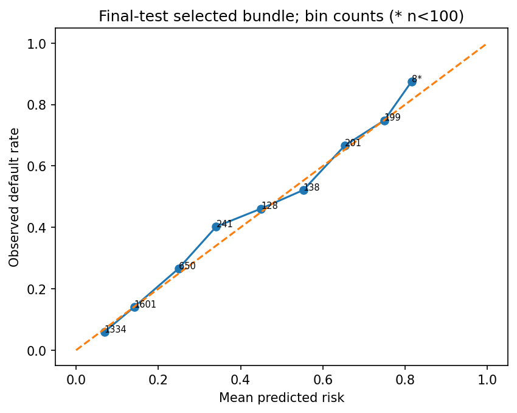
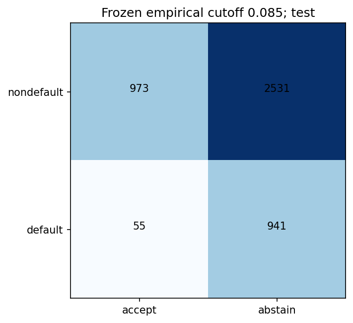
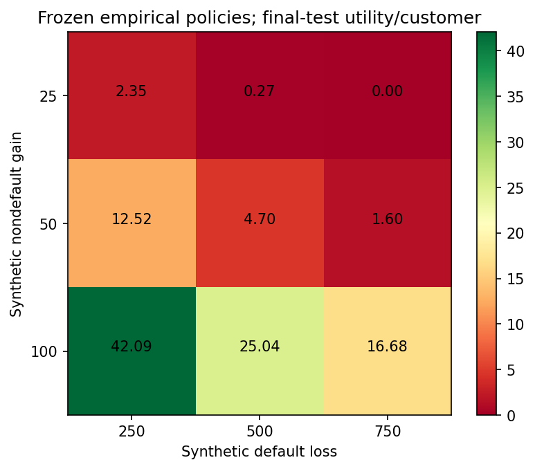

# Final evaluation and uncertainty

This study uses 30,000 historical Taiwanese credit-card customer snapshots, with April–September 2005 histories and the released next-month default indicator (positive class 1). Prediction occurs at the released month-end snapshot, assuming all included September information is available. Each customer contributes one labeled observation. This is an existing-account benchmark and a hypothetical allocation simulation.

The supplied workbook is UCI Default of Credit Card Clients (ID 350). Its SHA-256 is `30c6be3abd8dcfd3e6096c828bad8c2f011238620f5369220bd60cfc82700933`. It was subsequently verified byte-for-byte against the official UCI archive retrieved at `2026-10-10T18:00:23.006402Z`; recorded accepted, existing-local and official-member hashes all agree. The original acquisition date, download chain and original archive checksum remain unknown. Attribution: Yeh, I. (2009), UCI Machine Learning Repository, DOI 10.24432/C55S3H, CC BY 4.0. See the [new verification receipt](provenance/uci350-official-comparison-20261010T180023Z.json), unchanged [source manifest](../artifacts/source_manifest.json), [data contract](../docs/data_contracts.md) and [cleaning/reconciliation](database_reconciliation.json). This comparison does not reconstruct the original download chain or rerun scientific evaluation.

All 30,000 source, curated and exported records reconcile, with zero exclusions. Special repayment codes and signed bill balances are preserved. Sex, age, education and marital status are audit-only; identifiers and target never enter predictor matrices. The 19 raw financial predictors and 13 row-derived predictors use version financial-row-v1.1. Population-fitted imputation, vocabularies and scaling are restricted to development fit rows.

Four frozen partitions contain 18,000 development, 4,500 calibration, 3,000 policy-validation and 4,500 final-test customers. Identical raw financial profiles stay in the same partition and development CV fold. The final test contains 4,378 fingerprint clusters, including 996 defaults (22.133%). Seed 42 and five fixed development folds are preserved. [Split summary](split_summary.json) records all group counts/proportions.

Development evidence selected the 100-tree unweighted combined-feature XGBoost, xgboost_05_engineered_none. Final evidence does not change that selection. No minimum AP or boosted-model victory was required.

## Development: selection and ablation

The bounded development search completed 12 logistic, 12 forest and 24 XGBoost configurations across five folds (240 search fits). Search.fit runtime was 533.734s. The selected model's fold-average AP/ROC-AUC/log loss/Brier were 0.56125/0.78350/0.42652/0.13372. Candidates within 0.01 AP were compared using log loss and simplicity; tolerances are project choices, not significance tests. A 100-tree model was retained over the near-tied 200-tree candidate.

All 24 matched raw-versus-combined-feature contrasts improved development AP, log loss and Brier. Fold-local weighting worsened log loss/Brier in all 24 matched comparisons. These are tuning-sample findings, not independent test improvements. [Modeling methodology](../docs/modeling.md) explains the maintained contract. Full budgets, fold variation, runtimes and comparisons: [Phase 3 report](phase3.md), [model-selection table](phase3_selection_candidates.csv), [feature/weight ablation](phase3_controlled_comparisons_accepted.csv).

## Policy validation: calibration and policies

[Calibration and simulated policies](../docs/calibration_policies.md) describe the fit/selection boundaries and complete policy definitions.

The base and preprocessing were fitted on development only. Sigmoid/isotonic mappings were fitted on the separate 4,500-row calibration partition; raw probabilities were selected using 3,000 policy-validation rows. Validation log losses: raw 0.4329887140, sigmoid 0.4362283190, isotonic 0.4559940960. Raw minimized log loss and won the 0.005 simplicity rule. This comparison does not establish a globally best calibration method. [Calibration table](phase4_runs/9ca62eca2665438c9c97b4889413acfa/calibration_comparison.csv).

Payoffs are dimensionless synthetic units: nondefault gain 50, default loss 500, accepted-account processing cost 0. A standardized exposure is hypothetical and is not a customer's historical balance or a new loan. EU(accept)=(1-p)G-pL-C; EU(abstain)=0. The label-based benchmark assumes observed default would remain unchanged by hypothetical allocation. No causal effect, actual profit or avoided loss is estimated.

The analytic cutoff is 50/550; the empirically selected cutoff is 0.085. Strict p<cutoff accepts; ties abstain. Policy-validation benchmark utilities were 12,150 and 14,250 total units respectively. The fraction policies preserve numerical cutoffs 0.08965142071247101/0.1460030972957611/0.2732357978820801 rather than recalculating final-test percentiles. All policies/scenarios were independently reviewed and frozen before evaluation.

## Frozen final test

| Frozen candidate | AP | ROC-AUC | Log loss | Brier |
| --- | ---: | ---: | ---: | ---: |
| dummy_prior | 0.22133 | 0.50000 | 0.52859 | 0.17234 |
| logistic_00_engineered_none | 0.54155 | 0.78084 | 0.43520 | 0.13472 |
| random_forest_02_engineered_none | 0.56636 | 0.79501 | 0.42301 | 0.13288 |
| selected_bundle | 0.56422 | 0.79398 | 0.42331 | 0.13320 |
| xgboost_04_engineered_none | 0.56496 | 0.79535 | 0.42245 | 0.13286 |
| xgboost_05_engineered_none | 0.56422 | 0.79398 | 0.42331 | 0.13320 |

| Selected bundle statistic | Estimate [95% percentile interval] |
| --- | --- |
| average_precision | 0.56422 [0.53375, 0.59580] |
| roc_auc | 0.79398 [0.77763, 0.80965] |
| log_loss | 0.42331 [0.40652, 0.44119] |
| brier_score | 0.13320 [0.12662, 0.14062] |

The selected raw bundle and selected raw pipeline agree exactly. The forest AP exceeds the selected model by 0.00214, and the alternate frozen XGBoost AP exceeds it by 0.00074. Selected-minus-forest AP is −0.00214 with paired interval [−0.01017,0.00655]. Selected-minus-alternate-XGBoost AP is −0.00074 [−0.00554,0.00386]. The selected-minus-logistic AP difference is 0.02267 [0.00729,0.03671]; selected-minus-prior difference is 0.34288 [0.31404,0.37077]. These are conditional sample comparisons; the forest's test ranking does not replace the champion. All metrics, model differences and intervals: [models](phase5/models.csv), [intervals](phase5/intervals.csv), [exact JSON evidence](phase5/results.json).

## Frozen policy results: base synthetic payoffs

| Frozen policy | Cutoff | Accepted | Acceptance | Accepted default rate | Predicted EU/customer | Benchmark U/customer | Total U |
| --- | ---: | ---: | ---: | ---: | ---: | ---: | ---: |
| accept_all | N/A | 4500 | 1.00000 | 0.22133 | -70.25995 | -71.73333 | -322800.00000 |
| abstain_all | N/A | 0 | 0.00000 | N/A | 0.00000 | 0.00000 | 0.00000 |
| low_risk_fraction_0.25 | 0.08965 | 1129 | 0.25089 | 0.05492 | 3.70114 | 4.96667 | 22350.00000 |
| low_risk_fraction_0.5 | 0.14600 | 2296 | 0.51022 | 0.08493 | -0.19333 | 1.67778 | 7550.00000 |
| low_risk_fraction_0.75 | 0.27324 | 3372 | 0.74933 | 0.12100 | -13.88714 | -12.40000 | -55800.00000 |
| probability_0_5 | 0.50000 | 3954 | 0.87867 | 0.16034 | -31.92627 | -33.55556 | -151000.00000 |
| analytic | 0.09091 | 1160 | 0.25778 | 0.05517 | 3.70367 | 5.06667 | 22800.00000 |
| empirical | 0.08500 | 1028 | 0.22844 | 0.05350 | 3.65812 | 4.70000 | 21150.00000 |

The empirical policy accepts 1,028/4,500 accounts: 22.844% [21.511%,24.108%], with 55 accepted defaults and accepted default rate 5.350% [4.043%,6.746%]. Its total benchmark utility is 21,150 units; per-customer utility 4.70 [2.9012,6.3711]. Predicted expected utility totals 16,461.54 units (3.6581/customer). This difference is evaluation noise/probability quality under assumed payoffs, not an observed financial return.

The analytic policy yields 5.0667/customer; empirical-minus-analytic is −0.3667 [−0.9862,0.4165]. No final-test winner is used to choose a replacement policy. The frozen 50% fraction accepts 51.022% on test, which is allowed because its numerical cutoff stays unchanged.

For empirical high-risk detection, abstention is positive: TP 941, FP 2531, FN 55, TN 973. Precision 0.27103, recall 0.94478, F1 0.42122 and false-positive rate 0.72232 describe that declared operating point. The 0.5 reference is separately published; the majority hard reference flags no defaults and is not a probability baseline. Every policy's confusion/detection fields and predicted/benchmark totals are in [all 88 rows](phase5/policies.csv).

## Payoff sensitivity: fixed validation-selected empirical policies

| Synthetic scenario | Frozen empirical cutoff/kind | Accepted | Benchmark U/customer |
| --- | --- | ---: | ---: |
| g25_l250_c0 | 0.08500 | 1028 | 2.35000 |
| g25_l500_c0 | 0.06000 | 448 | 0.27222 |
| g25_l750_c0 | none | 0 | 0.00000 |
| g50_l250_c0 | 0.18000 | 2747 | 12.52222 |
| g50_l500_c0 | 0.08500 | 1028 | 4.70000 |
| g50_l750_c0 | 0.06000 | 448 | 1.60000 |
| g100_l250_c0 | 0.32000 | 3644 | 42.08889 |
| g100_l500_c0 | 0.18000 | 2747 | 25.04444 |
| g100_l750_c0 | 0.11500 | 1643 | 16.67778 |
| g50_l500_c5 | 0.08500 | 1028 | 3.55778 |

All eight policies are published for every scenario, including unfavorable results, in the 88-row table. G 25/L 750 retains validation-selected abstain-all: zero utility, zero acceptances and accepted default rate N/A. Costs are not adjusted to manufacture appealing outcomes. Under G 50/L 500/C 5, the same empirical cutoff yields 3.5578 units/customer. Synthetic policy results do not establish real-world approval or rejection outcomes.

## Uncertainty and evidence

Intervals use 1,000 seed 42 fingerprint-group samples with replacement, retaining every customer in each sampled cluster. The same draws support model and policy comparisons. There are 4,378 test groups; bootstrap row counts may vary with group size. Intervals are 95% percentiles. AP/ROC-AUC are omitted for one-class samples, while log loss/Brier remain defined. Empty accepted sets produce null (displayed N/A) accepted default rates. Every statistic records valid/undefined repetitions; no undefined rate is changed to zero. Core model/base-empirical intervals have 1,000 valid replicates. Abstain-all accepted default-rate intervals have 0 valid/1,000 undefined.

Intervals quantify evaluation-sample uncertainty conditional on fitted models and frozen policies. They omit development/search uncertainty and establish neither temporal nor external robustness. The bootstrap plan hash is `18ecf64cac061d62831872327e7bd08d5d2e3e4902acac4086529b879e61b447`.

Evaluation run `faa4d59ec05c408aacd3bd6560678c76` used the independently reviewed Phase 4 freeze `89bcf0263890353b2c72f7b6490bd8ec374f8935af2f621793c867dd03a8aa8b`, bundle `45d24e21b67e27c5a522863457d7774536b6af3608bb5e9bf6e6b06c030bdbcd`. All 106 frozen hashes were verified. Selected/reference fitted identities, preprocessing, raw mapping and policies remain unchanged. Saved prediction SHA `144e6861e40c65ed7871844a0dbf80a8ec707bdab38dcc863cdeea2fec8cf23c`. [Exposure receipt](phase5/test_exposure_receipt.json) records source/input/model identities; [exposure log](../docs/test-exposure-log.md) records accesses. Subsequent reporting uses saved evidence. Earlier complete-source diagnostic/stratification accesses are disclosed and did not guide model selection; the test was sealed from model-oriented analysis, not from all historical byte/string traversal.

## Explanations, audit and monitoring

Logistic coefficients use training-standardized scales/reference contrasts. SHAP explains the exact selected XGBoost's raw default log odds, using 100 development background rows and 996 development plus 4 preselected policy-validation cases. Maximum additivity residual is 1.43148e-6. It is not causal inference. Diagnostic cases were fixed before final evaluation and were not replaced by test examples. [Explanation contracts](../docs/explanations.md) and [recorded explanation evidence](phase4.md).

Demographic audit summaries are descriptive, restricted to policy validation, and suppressed below 100 rows or 20 of either class. No demographic-specific policies were optimized. Excluding demographics cannot establish fairness because financial predictors can encode proxies. No fairness certification is claimed.

Synthetic monitoring uses unchanged policy-validation records for labeled mix shifts and separate unlabeled corruption scenarios. Development-defined PSI bins retain underflow/overflow/missing bins with epsilon 1e-6 and renormalization. PSI warnings are heuristics; no temporal or concept drift is claimed and no retraining occurs. [Monitoring results](../docs/monitoring.md).

## Figures and limitations

[SHAP summary](phase4_runs/9ca62eca2665438c9c97b4889413acfa/shap_global.png), [first dependence](phase4_runs/9ca62eca2665438c9c97b4889413acfa/shap_dependence_1.png), [second dependence](phase4_runs/9ca62eca2665438c9c97b4889413acfa/shap_dependence_2.png) are included in this source checkout. Four frozen local waterfall examples remain in the separately supplied bundle and are unavailable from a source-only clone.

This historical existing-account sample supplies no dated future cohort, contemporary Canadian representativeness, new-applicant underwriting validation or lifetime-default evidence. No production deployment, intervention effect, real profit or fairness guarantee is claimed. Full-data refitting would create a new bundle requiring new validation. The original official-download chain remains a provenance limitation.
